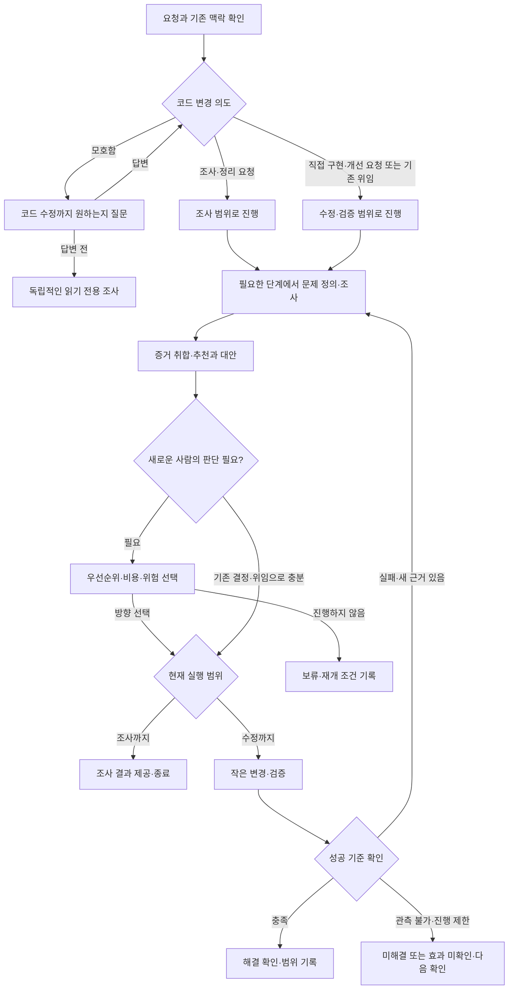

# Tackle 사용 흐름

독립 스킬 하나로 사용한다. `$tackle` 뒤에 문제와 원하는 작업 범위를 적는다. 이 문서는 사용자용 안내이며 에이전트의 실행 규칙은 `SKILL.md`에 있다.

예시:

- `$tackle 화면 로딩이 느려요.` → 코드 수정 의도 질문, 독립적인 조사 진행.
- `$tackle 로딩 성능을 개선해줘.` → 필요한 조사부터 코드 변경·검증까지.
- `$tackle 로딩 성능 개선 방안을 비교해줘.` → 판단 자료까지, 코드 변경 없음.
- `$tackle 앞서 선택한 방안으로 구현해줘.` → 기존 근거를 재사용해 수행·검증.

이전 HTML 다이어그램은 초기 설계안이다. 위 흐름에는 이후 합의한 모호한 요청의 실행 범위 확인이 반영돼 있다.
